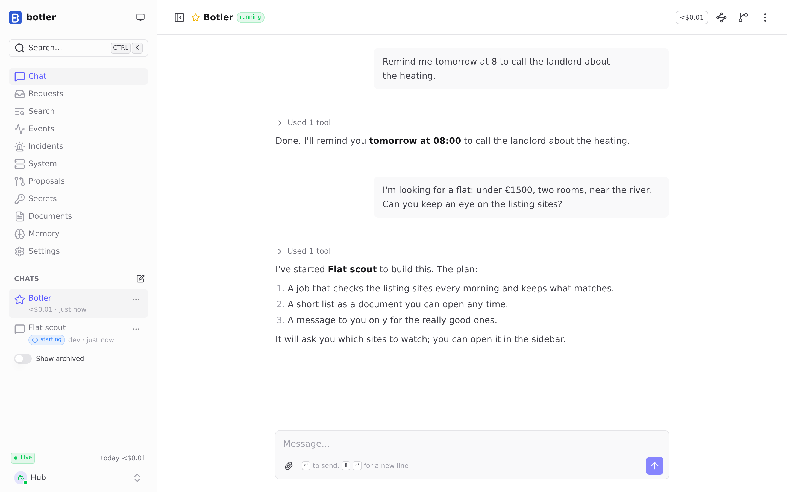
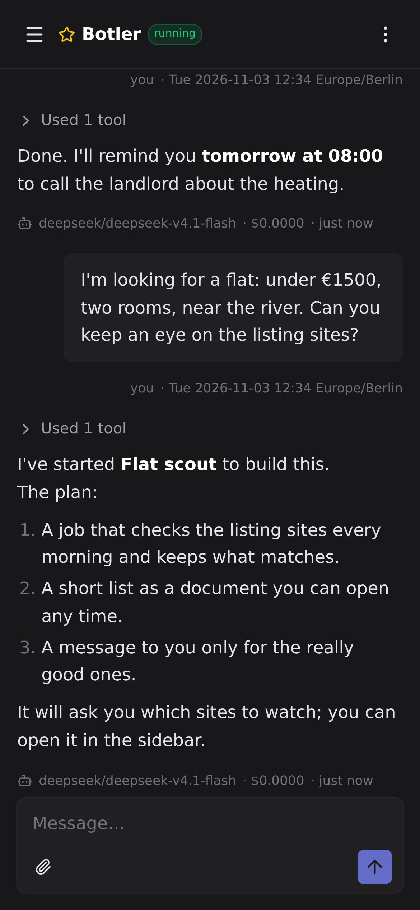
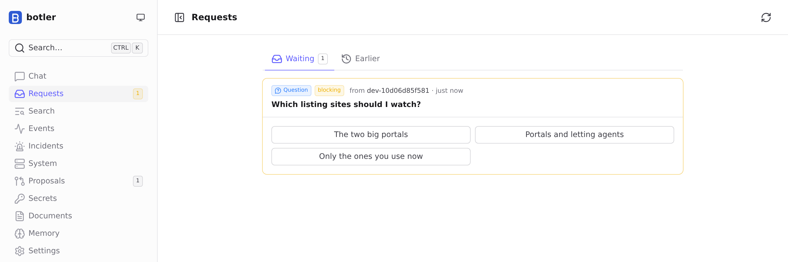
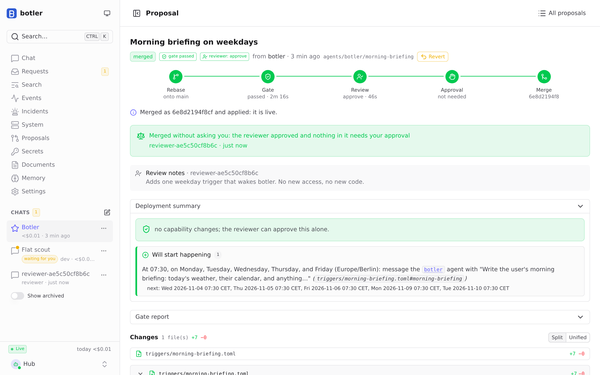

# botler

A personal, self-hosted system of AI agents that extends itself. You talk to **Botler** in a web
app (or on Discord, or wherever it builds a channel to). When you ask for something it can't do
yet (a scraper, a daily digest, a bot, a small app), an agent writes it as code in your own git
monorepo, it is checked, reviewed by a second agent, and, where it matters, approved by you before
it runs.

One Rust binary runs on a Linux machine you own. Agents are [pi](https://pi.dev) sessions in
rootless Podman containers; models come through [OpenRouter](https://openrouter.ai).



## What it has been used for

Most of these were built by botler's own agents, from a chat message, as code in the monorepo:

- **Discord as a front door.** DM Botler from your phone, `/remind me in 2h …`, or right-click any
  message → *Send to Botler*. Agents can DM you when something needs you. (Ships as an extra:
  ask Botler to set it up.)
- **A self-hosted Mattermost.** Botler runs Mattermost and its Postgres from the upstream images as
  services, with a bridge so the team chat is another channel to it, and posting tools its agents
  use for feeds.
- **Apartment hunting.** Scheduled jobs scrape listing sites into one shared format; a curator
  agent reads each new batch, checks promising listings in a real browser, keeps a shortlist
  document, posts good finds to a Mattermost channel and pings you only for the really good ones.
- **Tools for your own services**, e.g. querying a satellite ground station's upcoming passes,
  made available to every chat.
- **Coding** (ships with it): Botler hands larger work to a `dev` agent in its own chat, or starts a
  Claude Code session on your subscription that you can message while it works.

Out of the box it can search the web, find images, read pages, drive a real Chromium (Playwright
MCP), keep notes and memory, set timers, read and send files, and mount your network shares.

<p align="center">
  
  &nbsp;
  
</p>



## How it works

- **The hub** (`botler serve`) is the only fixed part: it wakes agents for messages, runs
  schedules and timers, supervises services, holds secrets and budgets, and serves the web app.
- **The monorepo** is everything else: agent definitions and prompts, jobs and services
  (Dockerfiles), triggers, tools, skills. Agents change it on a branch and call
  `propose_change`: a deterministic gate (lint, types, tests) runs, a reviewer agent reads the diff,
  and anything that widens access (a new secret, a published port, sending to other people) waits
  for your approval. The hub then applies `main`.
- **Safety by withholding**: secrets that can act on your behalf stay in the hub and are only used
  by approved actions; every agent has a daily budget; loops between agents trip breakers; there
  is a kill switch.

[`docs/ARCHITECTURE.md`](docs/ARCHITECTURE.md) has the full design and
[`docs/PRIMITIVES.md`](docs/PRIMITIVES.md) the few concepts everything is built from.

## Getting started

You need Linux with rootless Podman and an OpenRouter API key. Then:

```sh
mkdir -p ~/.config/botler/secrets
install -m 600 /dev/stdin ~/.config/botler/secrets/OPENROUTER_API_KEY   # paste the key, Enter, Ctrl-D
botler serve
```

The first start creates your monorepo, builds the agent image, and prints a link that signs your
browser in. [`docs/INSTALL.md`](docs/INSTALL.md) covers getting the binary, running it as a
service, reaching it from your phone (Tailscale), backups and upgrades.

## Developing

`./run-container.sh` builds the dev container (Rust, Node, uv, Podman for the hub's agents,
Chromium for end-to-end runs; also `.devcontainer/` for editors) and opens a shell in it. Inside or
on a host with the same tools:

```sh
cargo test --workspace                                   # unit + integration tests (fake runtime)
BOTLER_PODMAN_TESTS=1 cargo test -p botler-runtime       # also against a real Podman
(cd frontend && npm test && npm run e2e)                 # web app; e2e drives a throwaway hub
(cd pi-extension && npm ci --ignore-scripts && npm run typecheck)
```

| Path | What |
|---|---|
| `crates/` | the hub: `botler-core` (pure domain logic), `botler-store` (SQLite), `botler-repo` (the monorepo), `botler-runtime` (containers, pi RPC), `botler-hub` (the `botler` binary) |
| `frontend/` | the web app (Vue 3, Nuxt UI), compiled into the binary |
| `pi-extension/` | the pi extension every agent session loads |
| `python/botler-sdk/` | the Python SDK jobs and tools use |
| `template/` | the monorepo a new install starts from |
| `images/agent-base/` | the container image every agent builds on |
